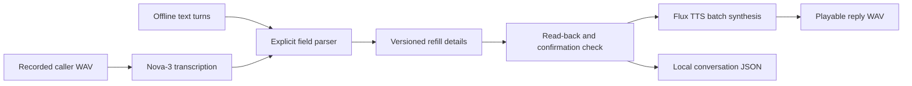

# Prescription Refill Voice Agent

A small, turn-based read-back assistant that retains a medication name, dosage, alphanumeric prescription reference, and pickup time across a conversation. Correcting the pickup time changes that field while preserving the other details. Each complete read-back receives a version-bound confirmation code, so an earlier confirmation cannot approve a later correction.

The offline demo runs without credentials. The audio mode accepts recorded WAV utterances, transcribes them with Deepgram Nova-3, applies the same local conversation logic, and synthesizes replies with Deepgram Flux TTS. It saves playable WAV files and a JSON trace. The examples contain synthetic, nonclinical details. Confirmation records agreement with a read-back locally; it does not order a refill, contact a hospital, or prescribe a medication or dose.

## Run

Python 3.11 or newer:

```powershell
python -m venv .venv
.venv\Scripts\Activate.ps1
python -m pip install -r requirements.txt
python -B -m refill_agent replay
python -B -m refill_agent replay --output artifacts/replay.json
python -B -m refill_agent chat
```

The replay retains `Canine Example Tablet`, `12.5 mg twice daily`, and `RX-7Q92`, changes pickup from `4:30 PM tomorrow` to `5:15 PM tomorrow`, then confirms the current revision. Its `{confirm_current}` fixture marker substitutes the displayed code; interactive users must supply the actual current code.

The intentionally explicit input grammar accepts one or more labeled details, separated by semicolons:

```text
medication is Canine Example Tablet; dosage is 12.5 mg twice daily
prescription number is RX-7Q92; pickup time is 4:30 PM tomorrow
Actually, pickup time is 5:15 PM tomorrow
summary
yes
```

`medication: ...`, `dosage: ...`, `prescription id: ...`, and `pickup time: ...` also work. Values retain their spelling and case; trailing sentence punctuation is removed. A reference may contain letters, digits, spaces and dashes. The response spells its characters individually. An unsupported or ambiguous turn is rejected atomically, leaving all existing details unchanged. Saying `yes` or `confirm` confirms only the current complete, offered read-back. A correction revokes the previous version and offers a fresh read-back. `confirm <the eight-character code>` also works and rejects stale codes explicitly. This parser does not infer details from unrestricted conversation, validate medical facts, or interpret relative dates.

## Recorded voice turns

This command makes paid API requests and uploads the supplied audio to Deepgram. Set your own key in the process environment; never place a real key in source files:

```powershell
$env:DEEPGRAM_API_KEY = "your-key-here"
python -B -m refill_agent audio turn1.wav turn2.wav --output-dir artifacts/audio-session
Start-Process artifacts/audio-session/reply-001.wav
```

Inputs must be mono, 16-bit PCM WAV, nonempty, and at most 25 MiB each. Use a fresh output directory for each session. The batch form processes pre-recorded turns in order. To record and provide the next turn after listening to each response, omit the input files:

```powershell
python -B -m refill_agent audio --output-dir artifacts/interactive-audio
```

Enter a WAV path on each line. Play the saved `reply-001.wav`, record the next utterance, and enter its path. Enter `quit` to finish. All turns share one in-memory conversation; the trace is checkpointed after every successfully synthesized reply. A process restart starts a new conversation. The local JSON contains the recognized details; use synthetic inputs for experiments.

The transport uses fixed `https://api.deepgram.com` endpoints, disables redirects and environment proxy inheritance, enforces timeouts and response size limits, and excludes response bodies and keys from errors. Recognition uses `POST /v1/listen?model=nova-3&smart_format=true&language=en`. Synthesis uses `POST /v2/speak?model=flux-haley-en&encoding=linear16&container=wav&sample_rate=24000` with `{"text": "..."}`. Both use `Authorization: Token ...`.

## Architecture



## CODE MAP

| File | Responsibility and connections |
| --- | --- |
| `refill_agent/__init__.py` | Declares the package. |
| `refill_agent/state.py` | Parses labeled updates atomically, preserves details, spells reference characters, tracks revisions and rejects stale confirmations. Used identically by every CLI mode. |
| `refill_agent/deepgram.py` | Validates PCM WAV, calls the documented Nova-3 and Flux REST endpoints, bounds transfers, and returns sanitized failures. Imported only by audio mode. |
| `refill_agent/__main__.py` | Runs offline replay, interactive text, and recorded-audio turns; writes exclusive replay output and audio-session traces. |
| `examples/refill.json` | Synthetic correction-and-confirmation conversation used by the default replay. |
| `tests/test_agent.py` | Tests exact field preservation, corrections, confirmation versions, atomic rejection, real CLI execution, WAV validation and mocked HTTP round trips. |
| `requirements.txt` | The single HTTP client dependency; offline replay and state tests use the standard library. |
| `.gitignore` | Excludes credentials, environments, caches and generated audio/traces. |

## Validation and limits

```powershell
$env:PYTHONDONTWRITEBYTECODE = "1"
python -B -m unittest discover -s tests -v
```

Tests do not contact a service. The HTTP contract tests supply synthetic transcription JSON and an actual in-memory PCM WAV, and exercise the CLI audio path. No real Deepgram request, audio quality, medication-name recognition accuracy, latency, or word error rate has been measured for this project.

This is a file-based turn loop, with a deterministic grammar instead of a generative model. It does not implement live microphone capture, telephony, streaming barge-in, cross-turn Flux WebSocket context, or the provider's complete voice-agent orchestration. Flux batch requests are stateless; conversation state lives in the local application. The displayed code is a short change identifier for a local demonstration, not authentication or a clinical approval mechanism.

## References

- [Flux TTS overview](https://developers.deepgram.com/docs/flux-tts/overview)
- [Flux batch REST contract](https://developers.deepgram.com/docs/flux-tts/batch)
- [Prerecorded transcription contract](https://developers.deepgram.com/docs/pre-recorded-audio)
- [Voice integration patterns](https://developers.deepgram.com/docs/flux-tts/voice-agent)
- [Upstream voice demo](https://github.com/deepgram/flux-tts-demo)
